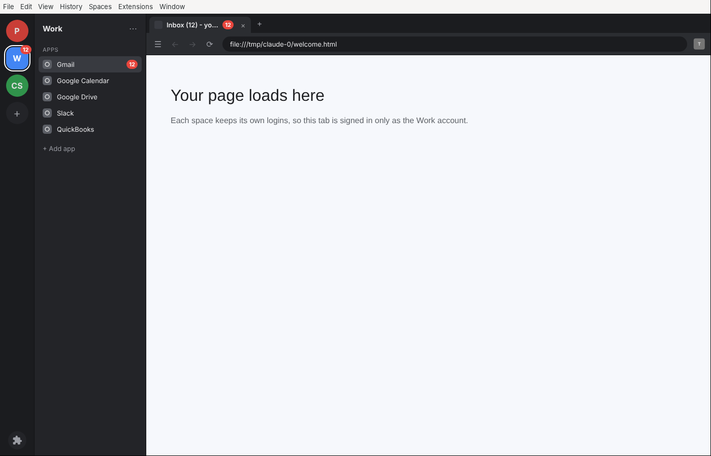

# MultiSpace Browser

A desktop browser for people who juggle several accounts, inspired by the "spaces + apps" layout of tools like Shift.
It runs on Chromium (through Electron), so sites behave the way they do in Chrome, and it can install **Chrome extensions straight from the Chrome Web Store**.



## What it does

- **Spaces = separate accounts.** Each space (the round icons on the far left) is a fully isolated browser profile with its own cookies, logins, and storage. Sign in to a different Gmail, Slack, or Facebook account in each space, all at the same time.
- **Apps aren't tabs.** Apps you pin open in their own place when you click them in the apps panel and stay loaded in the background; the tab strip only shows other websites you open. Cmd+W never closes an app.
- **Apps per space.** Pin web apps (Gmail, Calendar, Drive, Slack, WhatsApp, Outlook, QuickBooks, or any URL) in the panel next to the spaces. Clicking an app jumps to its tab, or opens it if it isn't open yet.
- **Unread badges.** Counts are read from page titles like `Inbox (12)`, then shown on the app, the tab, the space icon, and the dock/taskbar icon.
- **Tabs and an address bar** that work like Chrome's: search or type a URL, back/forward/reload, middle-click to close a tab.
- **Chrome extensions.**
  - Open the Chrome Web Store (puzzle icon at the bottom left, then **Open Chrome Web Store**) and click **Add to Chrome**.
  - Or load an unpacked extension folder (**Extensions → Load Unpacked Extension…**).
  - Extension toolbar buttons and popups show at the right end of the address bar, and extension right-click menu items appear in the page context menu.
  - Extensions are installed once and loaded into every space. Each space keeps its own extension data, just like separate Chrome profiles.
  - Installed Web Store extensions auto-update at startup and every 5 hours.
- **Remembers everything** between launches: spaces, apps, open tabs, and logins. Logins are written to disk every 30 seconds and again when you quit (even from Ctrl+C or closing the Terminal window), so WhatsApp Web and similar sites stay signed in. Opening the browser a second time just brings the open window forward, because two copies can't share the saved logins.
- **Open link in another space** from the right-click menu, so a link from one account can be opened while signed in as another.

## Passwords

- **Import your old passwords:** in Chrome or Shift go to Settings → Passwords (Google Password Manager) → Export passwords, which saves a `.csv` file. Then in this browser click the key icon at the bottom left (or **Passwords → Import Passwords**) and pick that file. You'll be offered to move the CSV to the Trash afterwards, since it isn't encrypted.
- Logins fill in automatically on their sites, in every space. If a site has several saved accounts, click the username box to pick one.
- When you sign in somewhere new, the browser offers to save the password.
- Passwords are encrypted with your Mac's Keychain and never leave the computer.

## iMessage (Mac only)

Add **iMessage** from **+ Add app**. It shows your conversations and lets you reply, with unread badges like the other apps.

- Three columns: the **Inbox** (favorites as big avatars on top, then conversations grouped by Today / Yesterday / This week / Earlier), the conversation, and a **details** panel (members, favorite, mark unread, open in Messages). The panel button at the top right shows or hides details.
- Filter by **All / Unread / Read / Favorites**. Right-click any conversation to mark it read or unread or add it to Favorites.
- Links in messages open as a tab in the same space.
- **Add to Contacts:** for a number that isn't saved, click the person+ button at the top (or **Add to Contacts** in the details panel). Name, phone, email and street address are filled in from what they texted you (highlight text in the chat first to use exactly that). Check the highlighted fields before saving. It's saved through the Mac's Contacts app to your default account (usually iCloud), so it shows on your iPhone too. The first time, macOS asks to let the browser control Contacts; click OK.
- **Send to team on WhatsApp:** right-click a message (or use the details panel) and pick **Send to team on WhatsApp**. Choose a teammate (add them once with their WhatsApp number), edit the message, and it opens your WhatsApp Web chat with them with the text already typed. Press Enter to send. For a WhatsApp group, pick "A group or someone else": the message is copied, so paste it into the group.
- **Swipe left to delete:** swipe a conversation left with two fingers on the trackpad (or drag it with the mouse) to show **Read/Unread** and **Delete**. A long swipe deletes right away, and **Undo** brings it back. Deleting removes it from this browser's list only (it comes back if they message again); it doesn't delete it from your iPhone or the Messages app.
- People who aren't in your Contacts but shared their name and photo with you show as their shared name with a **Maybe** tag, like in the Messages app. Phone numbers are shown as +1 (954) 804-5573.

- The first time, macOS needs to allow the browser to read your Messages history: System Settings → Privacy & Security → **Full Disk Access** → turn on **Terminal** (or **MultiSpace Browser** if you installed it as an app), then restart the browser.
- The first time you send, macOS asks to let it control **Messages**. Click OK.
- Photos and attachments show as "Attachment"; open them in the Messages app. Reading a message here doesn't mark it as read in Messages.

## Run it

You need [Node.js](https://nodejs.org) 20 or newer.

```bash
npm install
npm start
```

### Build an installer

```bash
npm run dist
```

This produces a `.dmg` on macOS, an `.exe` installer on Windows, or an AppImage on Linux in the `dist/` folder. (Build each platform on that platform. The installers are unsigned, so macOS and Windows will warn the first time you open them.)

## Keyboard shortcuts

| Action | Shortcut |
| --- | --- |
| New tab | Ctrl/Cmd + T |
| Close tab | Ctrl/Cmd + W |
| New space | Ctrl/Cmd + Shift + N |
| Go to space 1–9 | Ctrl/Cmd + 1…9 |
| Focus address bar | Ctrl/Cmd + L |
| Show/hide apps panel | Ctrl/Cmd + B |
| Back / Forward | Ctrl/Cmd + [ / ] |
| Zoom | Ctrl/Cmd + = / - / 0 |
| Page developer tools | Ctrl+Shift+I (Alt+Cmd+I on Mac) |

Right-click or double-click a space icon to rename it, change its color, reorder it, or delete it. Deleting a space signs you out of everything in it and wipes its data.

## How it works

| File | Purpose |
| --- | --- |
| `src/main.js` | Main process: windows, one Chromium session per space (`persist:space-<id>`), tabs, menus, extension wiring |
| `src/store.js` | Saves spaces, apps, and open tabs to `spaces.json` in the app's data folder; holds the app catalog |
| `src/ui-preload.js` | Safe bridge between the browser UI and the main process; registers the extension toolbar element |
| `src/ui/` | The browser chrome itself (spaces rail, apps panel, tab strip, toolbar, dialogs) in plain HTML/CSS/JS |

Chrome extension support comes from two open-source (MIT) libraries:
[`electron-chrome-extensions`](https://github.com/samuelmaddock/electron-browser-shell/tree/master/packages/electron-chrome-extensions) adds the `chrome.tabs`, `chrome.action`, `chrome.contextMenus`, `chrome.cookies`, `chrome.notifications`, `chrome.windows` and other APIs that plain Electron lacks, and
[`electron-chrome-web-store`](https://github.com/samuelmaddock/electron-browser-shell/tree/master/packages/electron-chrome-web-store) makes the Chrome Web Store's "Add to Chrome" button work and keeps extensions updated.

## Known limits

- **Not every extension will work.** Content-script extensions (ad blockers, Dark Reader, Grammarly-style helpers, password managers' autofill) generally work well. Extensions that need Chrome-only services such as `chrome.identity` (Google account sign-in inside the extension), Chrome Sync, or side panels may be partly or fully broken. Test the ones you rely on.
- **Google sign-in.** The browser identifies itself as regular Chrome so Google accounts can sign in. If Google ever shows "This browser or app may not be secure", sign in via a popup from another Google page (for example Drive), or let us know and we'll add a workaround.
- **No Chrome Sync or Google password manager.** Use a password-manager extension instead (Bitwarden, 1Password, LastPass).
- Not code-signed yet, and there is no auto-update of the app itself yet.

## Ideas for next steps

- Per-space notification controls and Do Not Disturb hours
- Quick switcher / search across all tabs in all spaces (Ctrl/Cmd + K)
- Import bookmarks and passwords from Chrome
- Lock a space behind a password, and sync spaces between computers
- Code signing and app auto-update
